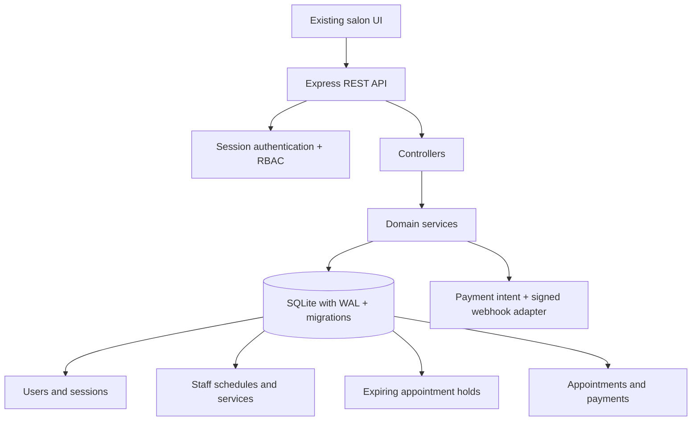

# Architecture and persistence decision

## Module boundaries

- `src/config`: environment-driven configuration.
- `src/database`: database connection, migration runner, and seed data.
- `src/middleware`: session authentication, role authorization, async routing, and error responses.
- `src/controllers`: HTTP request/response translation.
- `src/routes`: REST route declarations.
- `src/services`: authentication, booking/availability, and payment domain rules.
- `src/database/migrations`: versioned database schema.
- `test`: end-to-end API tests using an isolated database.

## PostgreSQL evaluation

PostgreSQL is the preferred production database for a multi-instance deployment because it provides stronger operational tooling, row/advisory locks, managed backups, and native exclusion constraints for time-range overlap. This repository currently uses SQLite WAL mode deliberately so the application remains self-contained and runnable without a separate service. The booking service keeps all transaction boundaries and overlap rules in one domain layer, which makes a PostgreSQL adapter a bounded follow-up migration rather than a UI rewrite.

The current implementation should be deployed as a single application instance when using SQLite. Do not claim horizontal scale or PostgreSQL-level operational guarantees until a PostgreSQL adapter and PostgreSQL integration CI job are added.
